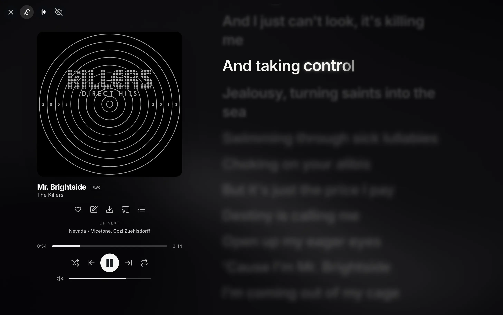

# \<am-lyrics>

[](https://www.npmjs.com/package/@uimaxbai/am-lyrics) [](https://www.npmjs.com/package/@uimaxbai/am-lyrics) [](https://www.jsdelivr.com/package/npm/@uimaxbai/am-lyrics)



<p align="center">Running on <a href="https://monochrome.tf">Monochrome</a> in fullscreen.</p>

This webcomponent follows the [open-wc](https://github.com/open-wc/open-wc) recommendation.

This web component is my take on Apple Music's word by word lyrics, utilises various APIs to fetch lyrics and the animations are inspired by [YouLy+](https://github.com/ibratabian17/YouLyPlus), [Apple Music-like Lyrics](https://github.com/amll-dev/applemusic-like-lyrics) and [LyricsBlossom](https://lyricsblossom.theoscarshen.com/)'s Swift reference. It's designed to be faithful while also being lightweight and able to run on all major browsers and many mid-to-high end devices smoothly. Because it's a Web Component, it's also really easy to use!

## Installation

```bash
npm install @uimaxbai/am-lyrics # Or your package manager of choice
```

Or just use CDN (below).

## Usage

```html
<script type="module">
  import 'https://cdn.jsdelivr.net/npm/@uimaxbai/am-lyrics/dist/src/am-lyrics.min.js';
</script>

<am-lyrics
  song-title="Uptown Funk"
  song-artist="Mark Ronson"
  song-album="Uptown Special"
  song-duration="269000"
  query="Uptown Funk Mark Ronson"
  current-time="0"
  duration=""
  highlight-color="#f00"
  font-family="'Inter', Arial, sans-serif"
  autoscroll
  interpolate
></am-lyrics>
```

## Properties & Attributes

| Property/Attribute       | Type      | Default     | Description                                                                                    |
| ------------------------ | --------- | ----------- | ---------------------------------------------------------------------------------------------- |
| `query`                  | `string`  | `undefined` | Search phrase for lrc.red, with LyricsPlus catalog fallback |
| `music-id`               | `string`  | `undefined` | Specific Apple Music song ID (served through the backup Apple endpoint)                        |
| `spotify-id`             | `string`  | `undefined` | Spotify track ID for Spicy Lyrics; skips the Spotify search when supplied                       |
| `isrc`                   | `string`  | `undefined` | ISRC code for direct lrc.red TTML lookup and provider matching |
| `ttml`                   | `string`  | `undefined` | A string of TTML formatted lyrics to be rendered directly (bypasses all external requests)     |
| `song-title`             | `string`  | `undefined` | Track title for lrc.red and fallback providers |
| `song-artist`            | `string`  | `undefined` | Artist name for lrc.red and fallback providers |
| `song-album`             | `string`  | `undefined` | Optional album name for provider matching |
| `song-duration`          | `number`  | `undefined` | Optional song duration in milliseconds sent to LyricsPlus                                      |
| `current-time`           | `number`  | `0`         | Current playback time in milliseconds                                                          |
| `duration`               | `number`  | `undefined` | Playback timer duration in milliseconds. **Set to `-1` to reset/stop playback**                |
| `highlight-color`        | `string`  | `"#fff"`    | Color for highlighted/active lyrics                                                            |
| ~~`hide-source-footer`~~ | `boolean` | `false`     | Hide/show the source attribution footer                                                        |
| `font-family`            | `string`  | `undefined` | Custom font family for lyrics                                                                  |
| `autoscroll`             | `boolean` | `true`      | Enable automatic scrolling to active lyrics                                                    |
| `interpolate`            | `boolean` | `true`      | Enable smooth word-by-word highlighting animation                                              |

## CSS Custom Properties (CSS Variables)

You can customize the appearance using CSS custom properties:

```css
am-lyrics {
  /* Highlight color for active lyrics */
  --am-lyrics-highlight-color: #007aff;

  /* Alternative highlight color (fallback) */
  --highlight-color: #000;

  /* Swift-derived layout and motion defaults */
  --lyplus-font-size-base: 34px;
  --am-lyrics-line-height: 1.2;
  --am-lyrics-line-spacing: 25px;
  --am-lyrics-background-vocal-spacing: 15px;
  --am-lyrics-background-vocal-font-size: 0.65em;
  --am-lyrics-background-vocal-stack-shift: 7.5px;
  --am-lyrics-background-vocal-max-height: 8em;
  --am-lyrics-background-vocal-exit-duration: 450ms;
  --am-lyrics-instrumental-height: 40px;
  --am-lyrics-instrumental-spacing: 16px;
  --am-lyrics-instrumental-enter-duration: 400ms;
  --am-lyrics-instrumental-collapse-duration: 500ms;
  --am-lyrics-instrumental-exit-duration: 350ms;
  --am-lyrics-instrumental-exit-scale: 0;
  --am-lyrics-inactive-scale: 0.98;
  --am-lyrics-background-vocal-scale: 0.9;
  --am-lyrics-touch-scale: 0.96;
  --am-lyrics-highlight-radius: 16px;
  --am-lyrics-highlight-surface: rgba(255, 255, 255, 0.08);
  --am-lyrics-progression-feather: 30px;
  --am-lyrics-glow-radius: 5px;
  --am-lyrics-character-rise-peak: -1.25px;
  --am-lyrics-inline-padding: 20px;
  --lyrics-scroll-padding-top: 12%;
  --am-lyrics-compact-font-size: 28px;
  --am-lyrics-compact-background-vocal-font-size: 0.857em;
  --am-lyrics-compact-line-spacing: 20px;
  --am-lyrics-compact-selected-position: 18%;
  --am-lyrics-wide-font-size: 48px;
  --am-lyrics-wide-background-vocal-font-size: 0.667em;
  --am-lyrics-wide-line-spacing: 32px;
  --am-lyrics-wide-selected-position: 20%;
}
```

## Sources

Thank you to these providers who generously allow me to use their lyrics in my component:

[lrc.red](https://lrc.red), [BiniLyrics](https://lyrics.binimum.org), [Spicy Lyrics](https://spicylyrics.org), [Unison](https://unison.boidu.dev), [LRCLib](https://lrclib.net/), [Genius](https://genius.com/)

And also thank you to anyone I might have missed!

## Events

### `line-click`

Fired when a user clicks on a lyrics line.

```javascript
amLyrics.addEventListener('line-click', event => {
  console.log('Seek to:', event.detail.timestamp); // timestamp in milliseconds
});
```

### For React Users

First, ensure you have `react` and `@lit/react` installed in your project.

```bash
npm install react @lit/react # Very important or errors will arise
```

Then, you can import the `AmLyrics` component from `am-lyrics/react` and use it in your components.

```jsx
'use client'; // VERY IMPORTANT!!!

import React, { useState, useCallback, useRef, useEffect } from 'react';
import { AmLyrics } from '@uimaxbai/am-lyrics/react';

export default function App() {
  const [currentTime, setCurrentTime] = useState(0);
  const audioRef = useRef<HTMLAudioElement>(null);

  // Sync audio player time with the component
  useEffect(() => {
    const audio = audioRef.current;
    if (!audio) return;

    let animationFrameId: number;

    const updateCurrentTime = () => {
      setCurrentTime(audio.currentTime * 1000);
      animationFrameId = requestAnimationFrame(updateCurrentTime); // Use requestAnimationFrame to prevent choppy scrolling
    };

    const handlePlay = () => {
      animationFrameId = requestAnimationFrame(updateCurrentTime);
    };

    const handlePause = () => {
      cancelAnimationFrame(animationFrameId);
    };

    const handleTimeUpdate = () => {
      setCurrentTime(audio.currentTime * 1000); // Convert to milliseconds
    };

    audio.addEventListener('play', handlePlay);
    audio.addEventListener('pause', handlePause);
    audio.addEventListener('timeupdate', handleTimeUpdate);

    return () => {
      cancelAnimationFrame(animationFrameId);
      audio.removeEventListener('play', handlePlay);
      audio.removeEventListener('pause', handlePause);
      audio.removeEventListener('timeupdate', handleTimeUpdate);
    };
  }, []);

  // Handle line clicks to seek the audio
  const handleLineClick = useCallback((event: Event) => {
    const customEvent = event as CustomEvent<{ timestamp: number }>;
    const audio = audioRef.current;
    if (audio) {
      audio.currentTime = customEvent.detail.timestamp / 1000; // Convert to seconds
      audio.play();
    }
  }, []);

  return (
    <div>
      <audio ref={audioRef} src="/uptown_funk.flac" controls />
        <AmLyrics
          songTitle="Uptown Funk"
          songArtist="Mark Ronson"
          query="Uptown Funk Mark Ronson"
          currentTime={currentTime}
          onLineClick={handleLineClick}
          autoScroll
          highlightColor='#fff'
        />
    </div>
  );
}
```

Using NextJS? See [`next.md`](./next.md).

### SSR

Lit web components only partially support SSR, so this package is very volatile in SSR. Either:

- Use the CDN solution and place it direct into your HTML or
- Disable SSR on the page with lyrics.

Using NextJS? See [`next.md`](./next.md).

The timer needs to be defined by yourself. For example:

### Just play the lyrics

```html
<script>
  let animationFrameId;
  let songStartTime = 0;
  let systemStartTime = 0;

  function stopAnimation() {
    if (animationFrameId) {
      cancelAnimationFrame(animationFrameId);
      animationFrameId = null;
    }
  }

  function animate() {
    const amLyrics = document.querySelector('am-lyrics');
    if (!amLyrics) return;

    const elapsedTime = Date.now() - systemStartTime;
    amLyrics.currentTime = songStartTime + elapsedTime;

    animationFrameId = requestAnimationFrame(animate);
  }

  function startPlayback() {
    stopAnimation();
    songStartTime = 0;
    systemStartTime = Date.now(); // Use dates instead of setInterval() for more accuracy
    animate();
  }

  function handleLineClick(e) {
    stopAnimation();
    songStartTime = e.detail.timestamp;
    systemStartTime = Date.now();
    animate();
  }

  function handleSearch() {
    const searchInput = document.querySelector('#search-input');
    const amLyrics = document.querySelector('am-lyrics');
    if (searchInput && amLyrics) {
      // Expect "Title - Artist" in the search field for optimal LyricsPlus results
      const userInput = searchInput.value.trim();
      const [titlePart = '', artistPart = ''] = userInput
        .split(' - ')
        .map(part => part.trim());

      amLyrics.songTitle = titlePart || userInput;
      amLyrics.songArtist = artistPart;
      amLyrics.query = userInput;
      amLyrics.isrc = '';
      amLyrics.musicId = '';
    }
  }

  document.addEventListener('DOMContentLoaded', () => {
    const amLyrics = document.querySelector('am-lyrics');
    const searchButton = document.querySelector('#search-button');
    const startButton = document.querySelector('#start-button');

    if (amLyrics) {
      amLyrics.addEventListener('line-click', handleLineClick);
    }

    if (searchButton) {
      searchButton.addEventListener('click', handleSearch);
    }

    if (startButton) {
      startButton.addEventListener('click', startPlayback);
    }
  });
</script>
```

### With an `<audio>` element

You can synchronize the lyrics with an HTML `<audio>` element.

```html
<audio id="audio-player" src="path/to/your/song.mp3" controls></audio>
<am-lyrics
  song-title="Uptown Funk"
  song-artist="Mark Ronson"
  query="Uptown Funk Mark Ronson"
></am-lyrics>

<script>
  document.addEventListener('DOMContentLoaded', () => {
    const amLyrics = document.querySelector('am-lyrics');
    const audioPlayer = document.querySelector('#audio-player');

    if (amLyrics && audioPlayer) {
      // Update lyrics time when audio time updates
      audioPlayer.addEventListener('timeupdate', () => {
        // The component expects time in milliseconds
        amLyrics.currentTime = audioPlayer.currentTime * 1000;
      });

      // Seek audio when a lyric line is clicked
      amLyrics.addEventListener('line-click', e => {
        // The event detail contains the timestamp in milliseconds
        audioPlayer.currentTime = e.detail.timestamp / 1000;
        audioPlayer.play();
      });
    }
  });
</script>
```

See [`demo/index.html`](./demo/index.html) for a functional demo.

## Development

### Dependencies

```bash
npm i
yarn install
bun i
```

### Local demo with `web-dev-server`

```bash
npm start
```

### The usual

To scan the project for linting and formatting errors, run

```bash
npm run lint
```

To automatically fix linting and formatting errors, run

```bash
npm run format
```
